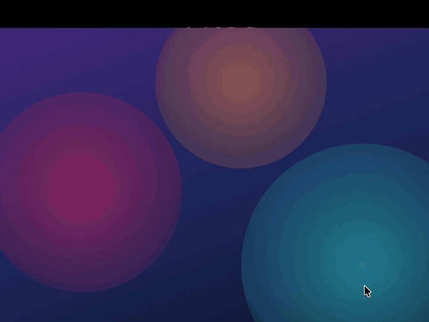
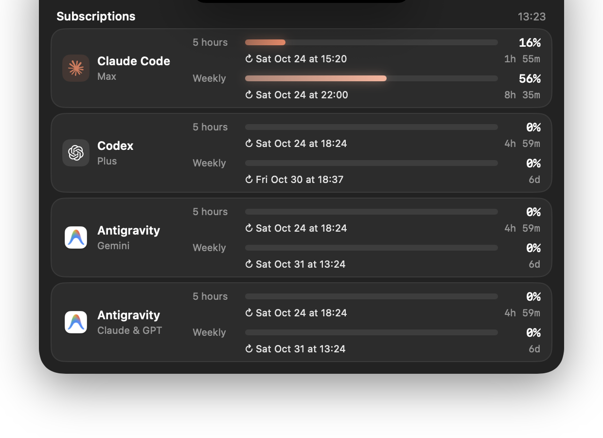

# Agentch

**Agentch** (agent + notch) is a tiny macOS app that lives in your MacBook's notch and shows how much of your AI coding subscriptions you have left.

Hover over the notch and it springs open with the limits for each agent (5-hour, weekly or monthly), when each window resets and how long until it does. Move the pointer away and it folds back into an empty notch.

<p align="center">
  
</p>

## Supported subscriptions

| Agent | Plan shown | Where the data comes from |
| --- | --- | --- |
| **Claude Code** | Pro / Max | Anthropic's OAuth usage endpoint, using the token Claude Code stores in the login Keychain |
| **Codex** | Plus / Pro | `codex app-server` (`account/rateLimits/read`) |
| **Cursor** | Free / Pro / Ultra | cursor.com usage summary, using the token `cursor-agent login` stores in the Keychain. Shows the monthly plan usage and on-demand spending |
| **GitHub Copilot** | Free / Individual / Business | `copilot_internal/user`, using the token from the Copilot editor extensions or any account signed in to the GitHub CLI (`gh`). Shows monthly premium requests |
| **Grok** | SuperGrok | Grok CLI billing endpoint, using the token `grok login` stores in `~/.grok/auth.json` |
| **Muse Code** | Meta | `api.meta.ai/muse-code/key`, using the token `muse login` stores in the Keychain. Shows the 5-hour and weekly windows |
| **Antigravity** | Gemini, and Claude & GPT pools | `agy -p /usage --output-format json` |

Every provider reads from the official CLI or credentials you already have on your Mac. Agentch has no account and no servers, and it doesn't depend on any third-party tool.

Bars turn amber once a window passes 80 %. Data refreshes every two minutes, and again when you open the panel if it is older than 30 seconds.

<p align="center">
  
</p>

## Requirements

- macOS 14 or later (a Mac with a notch looks best; other displays get a notch-sized area under the menu bar)
- Xcode 16+ and [XcodeGen](https://github.com/yonaskolb/XcodeGen)
- Whichever tools you want to track, signed in: `claude`, `codex`, `cursor-agent`, `gh` or a Copilot editor extension, `grok`, `muse`, `agy`. Tools that aren't installed or signed in are simply hidden.

## Build and run

```sh
xcodegen generate
xcodebuild -project Agentch.xcodeproj -scheme Agentch -configuration Debug -derivedDataPath build build
open build/Build/Products/Debug/Agentch.app
```

Out of the box the app is signed ad hoc with the bundle ID `com.example.agentch`, so no Apple account is needed. With ad-hoc signing macOS treats every rebuild as a new app and asks again for Keychain access to Claude Code's credentials. To avoid that, sign with your own identity:

```sh
cp Config/Local.xcconfig.example Config/Local.xcconfig
# then set BUNDLE_ID_PREFIX, CODE_SIGN_IDENTITY and DEVELOPMENT_TEAM
xcodegen generate
```

`Config/Local.xcconfig` is git-ignored.

Click the gear in the panel header (or right-click the panel) for **Settings**; the context menu also has **Refresh Now** and **Quit Agentch**. Settings has two tabs:

- **Appearance**: pick a theme (Midnight, Graphite, Ocean, Aurora, Forest or the light Daylight), set the panel opacity and turn the background blur on or off, with a live preview.
- **Subscriptions**: every provider with its connection status and a switch; turned-off subscriptions are hidden and never queried. To keep the panel open while working on the UI:

```sh
open build/Build/Products/Debug/Agentch.app --args -pinOpen YES      # keep the panel open
open build/Build/Products/Debug/Agentch.app --args -showSettings YES # open Settings at launch
```

Logs:

```sh
/usr/bin/log show --last 5m --info --predicate 'subsystem == "com.example.agentch"'   # your bundle ID
```

## Project layout

```
Config/       Build settings (bundle ID, signing)
Agentch/
  App/        App entry point and delegate
  Appearance/ Themes and the opacity/blur settings
  Notch/      Notch geometry, panel window, hover handling and animated shape
  Limits/     The expanded view: provider rows, limit bars, formatting
  Settings/   The Settings window
  Usage/      UsageStore, models and one provider per subscription
```

Adding a subscription means writing a type that conforms to `UsageProvider` and adding it to the list in `AppDelegate`.

## License

[MIT](LICENSE)
